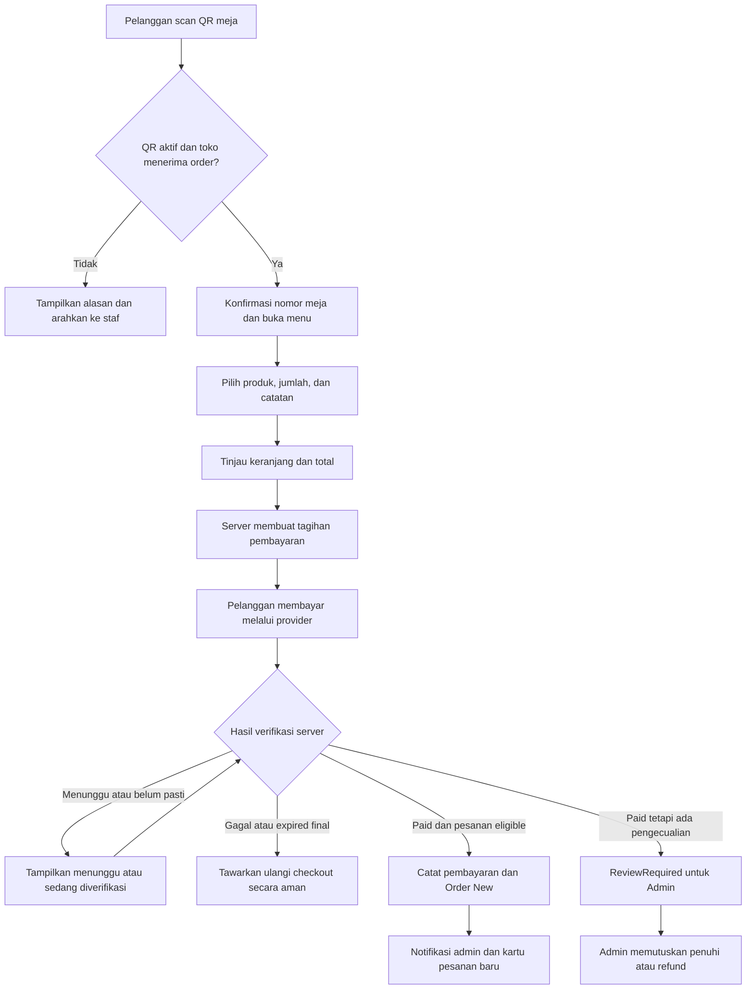
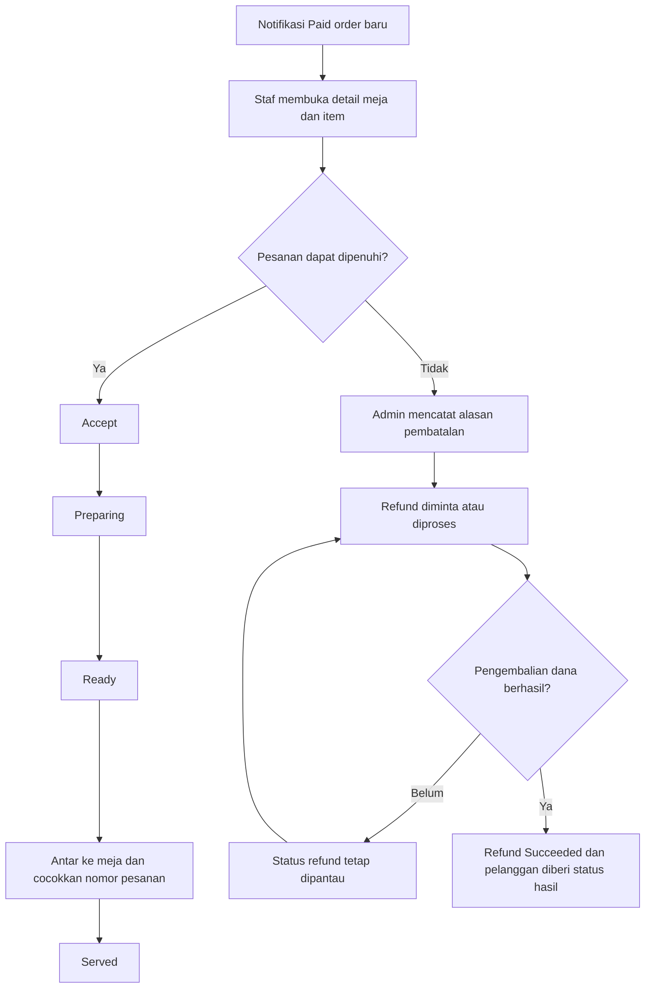

# Alur Bisnis Aplikasi Pemesanan QR Meja

Produk: **PosyMart Table Order** · Versi 1.0 · 11 Oktober 2026  
Spesifikasi lengkap: [PRD Aplikasi Pemesanan QR Meja](./PRD.md)

## 1 Cara kerja utama

Pelanggan duduk di meja, memindai QR, memilih minuman/makanan, dan **membayar terlebih dahulu**. Setelah server memastikan pembayaran melalui penyedia pembayaran, pesanan masuk ke dashboard dan notifikasi Admin/Kasir. Staf menyiapkan lalu mengantar ke meja tersebut.

Pelanggan tidak perlu membuat akun POS. Nama panggilan boleh diisi, tetapi nomor meja dan nomor pesanan sudah menjadi identitas layanan. Yang login ke dashboard operasional adalah Admin/Kasir.

Ada dua kode dengan fungsi berbeda:

| Kode | Fungsi | Masa penggunaan |
| --- | --- | --- |
| QR meja | Membuka menu kafe dan menetapkan konteks meja | Dipasang/cetak untuk meja; dapat dipakai berulang selama aktif |
| QR/tagihan pembayaran | Membayar satu nominal pesanan melalui provider | Berlaku untuk payment attempt dan batas waktu tertentu |

QR meja tidak berisi nomor tagihan yang dipakai bersama semua pelanggan. Setiap checkout mempunyai reference pembayaran sendiri.

## 2 Persiapan toko dan minimal 50 QR

1. Admin menyiapkan katalog, harga, produk tersedia, jam operasional, metode pembayaran, serta pajak/biaya bila digunakan.
2. Admin menghubungkan akun merchant provider pada lingkungan yang benar dan menguji pembayaran serta refund.
3. Sistem menyediakan minimal 50 identitas titik layanan: `T001–T050`, label `Meja 01–Meja 50`, dan QR ID `QR-T001–QR-T050`.
4. Admin memeriksa nama/nomor meja; meja yang belum digunakan dapat tetap nonaktif.
5. Backend membuat token unik untuk setiap QR dan mengaitkannya ke domain pemesanan.
6. Admin mencetak kartu QR satuan atau batch, lalu menempelkan kartu yang benar pada meja yang benar.
7. Staf memindai **seluruh 50 QR** dan mencocokkan nomor di website dengan nomor fisik. QR yang lolos dan akan dipakai diaktifkan.
8. Admin membuka dashboard pesanan, mengaktifkan suara jika diinginkan, dan memastikan koneksi dashboard tersedia sebelum menerima order.

Daftar lengkap 50 identitas terdapat pada bagian 6.4 PRD. Pembuatan gambar QR produksi dilakukan setelah domain dan mapping tersedia; angka “50” tidak sekadar jumlah gambar yang semuanya menuju meja sama.

## 3 Alur pelanggan sampai pesanan diterima staf

### Langkah 1 Scan dan konfirmasi meja

Pelanggan membuka kamera ponsel dan memindai QR di Meja 17. Website menampilkan nama kafe dan **Meja 17**. Pelanggan memastikan nomor benar sebelum memilih menu.

Jika nomor tidak sesuai tempat duduk, pelanggan memindai kartu meja yang benar atau meminta bantuan staf. Nomor meja pada website tidak diganti sembarang dari alamat URL oleh pelanggan.

### Langkah 2 Memilih menu

Pelanggan melihat foto, harga, kategori, dan ketersediaan. Pelanggan dapat mengatur jumlah, memilih opsi produk yang disediakan, serta menulis catatan seperti “less sugar”. Produk habis tidak dapat dibeli.

Keranjang masih milik sesi pelanggan tersebut. Orang lain di meja yang sama dapat membuat keranjang sendiri tanpa melihat data pesanan pelanggan pertama.

### Langkah 3 Checkout

Halaman menampilkan nomor meja, item/opsi, jumlah, catatan, total, diskon/pajak/biaya yang berlaku, serta nama panggilan opsional. Pelanggan menekan `Pesan & Bayar` setelah meninjau semuanya.

Server mengecek ulang harga, ketersediaan, toko/meja aktif, dan promo. Jika ada perubahan, pelanggan diminta meninjau total baru. Snapshot yang disetujui dipakai untuk tagihan.

### Langkah 4 Membayar

Pelanggan diarahkan ke alur pembayaran provider. Untuk QRIS, jalur satu ponsel harus sudah diuji: buka aplikasi yang didukung, atau gunakan instruksi simpan QR/metode lain yang memang tersedia pada kanal tersebut.

Selama status masih menunggu, pesanan belum menjadi pekerjaan barista. Pelanggan boleh melihat timer resmi tagihan, tetapi habisnya timer layar tidak membuktikan dana belum masuk.

### Langkah 5 Verifikasi otomatis

Server menerima pemberitahuan provider atau memeriksa status langsung. Identitas transaksi dan nominal dicocokkan. Tombol pelanggan “Periksa pembayaran” hanya meminta pemeriksaan server; tombol tersebut tidak menandai lunas sendiri.

Halaman kembali dari provider bukan bukti pembayaran final. Desain verifikasi server mengikuti prinsip autentikasi dan pemeriksaan status pada [dokumentasi provider](https://docs.midtrans.com/docs/https-notification-webhooks).

### Langkah 6 Membuat pesanan kerja

Sesudah pembayaran valid dan pesanan dapat dipenuhi, server menyimpan Sale, status Paid, perubahan stok, serta Order **New**. Notifikasi admin dibuat setelah penyimpanan ini berhasil.

Jika pembayaran valid tetapi reservasi stok sudah hilang atau ada kendala, dana tetap tercatat. Pesanan masuk **ReviewRequired**, sehingga Admin menangani masalah sebelum menyuruh staf membuat minuman.

## 4 Alur Admin dan Kasir

1. Dashboard menampilkan badge/notifikasi dan, jika diizinkan browser, suara.
2. Staf melihat meja, nomor pesanan, nama opsional, item, jumlah, catatan, total, dan Paid.
3. Staf menekan `Accept`. Membaca notifikasi saja tidak berarti pesanan sudah diambil.
4. Staf menekan `Start Preparing` ketika mulai membuat.
5. Setelah siap, staf menekan `Mark Ready`.
6. Staf mengantar ke meja yang tercatat, memastikan nomor pesanan, lalu menekan `Mark Served`.
7. Pelanggan melihat perubahan status pada halaman pesanannya.

Tidak ada penagihan ulang saat Accept atau Served. Tindakan tersebut juga tidak membuat penjualan atau pengurangan stok kedua kali.

## 5 Contoh transaksi dari Meja 17

| Informasi | Contoh |
| --- | --- |
| QR meja | QR-T017 |
| Meja | Meja 17 |
| Nama opsional | Rani |
| Nomor pesanan | Q-20261011-041 |
| Cappuccino | 2 × Rp25.000 = Rp50.000 |
| Bagel | 1 × Rp18.000 = Rp18.000 |
| Diskon/pajak/biaya fixture | Rp0 |
| Total tagihan | Rp68.000 |
| Pembayaran | QRIS melalui provider |
| Sebelum pembayaran sah | Pending; tidak masuk antrean produksi |
| Sesudah pembayaran sah | Paid + New; Admin mendapat notifikasi Meja 17 |
| Tahap layanan | Accepted → Preparing → Ready → Served |

Harga adalah contoh pengujian. Jika Rani ingin memesan lagi sesudah pembayaran, buat Order baru dengan tagihan baru. Pesanan pertama tetap mempunyai rincian dan total yang sama.

## 6 Pembayaran dan kondisi pengecualian

| Kejadian | Yang dilihat pelanggan | Tindakan sistem/staf |
| --- | --- | --- |
| Belum membayar | Menunggu pembayaran | Tidak ada antrean produksi |
| Pembayaran ditolak provider | Pembayaran gagal | Pastikan attempt lama terminal sebelum retry |
| Pelanggan sudah membayar tetapi status lambat | Sedang memverifikasi; Periksa pembayaran | Backend query provider; Admin tidak memakai Force Paid |
| Redirect sukses tetapi belum ada hasil sah | Sedang memverifikasi | Tunggu/reconcile; jangan langsung mulai membuat |
| Waktu tagihan habis tanpa pembayaran | Tagihan kedaluwarsa setelah hasil dikonfirmasi | Lepas reservasi dan tawarkan checkout baru |
| Uang masuk terlambat setelah stok dilepas | Pembayaran diterima, pesanan sedang ditinjau | ReviewRequired; alokasikan stok lagi atau refund |
| Callback provider dua kali | Tetap satu nomor pesanan | Dedup; jangan cetak pekerjaan atau kurangi stok dua kali |
| Dua tagihan untuk Order sama ternyata dibayar | Status pesanan tetap satu; dana lebih perlu ditangani | Catat kedua receipt, refund kelebihan; jangan membuat dua pesanan |
| Nominal/order reference tidak cocok | Perlu pemeriksaan pembayaran | Catat event dan investigasi; tidak masuk produksi |
| Admin tidak dapat memenuhi order Paid | Pembatalan layanan dan status refund | Alasan wajib; pantau sampai pengembalian selesai |
| Refund belum berhasil | Refund sedang diproses/gagal | Admin menindaklanjuti; tidak menampilkan uang sudah kembali |

Pengembalian dana berbeda dari membatalkan persiapan. Order dapat Cancelled sementara refund masih Processing. Catatan dana tidak dihapus untuk menyederhanakan tampilan.

## 7 Pengelolaan meja dan QR sehari-hari

### Membuka meja

Admin memastikan kartu nomor meja cocok dan QR aktif. Tidak perlu mencetak ulang setiap ada pelanggan baru; Order baru dipisahkan melalui sesi dan nomor pesanan.

### Menonaktifkan meja sementara

Admin menonaktifkan penerimaan pesanan baru pada QR/meja terkait. Pelanggan yang baru memindai mendapat pesan untuk menghubungi staf. Pembayaran yang sudah berjalan tetap diperiksa; Order yang sudah dibayar tetap harus dipenuhi atau direfund.

### Kartu rusak atau ingin mengganti QR

Admin membuat token baru lewat `Rotate QR`, mencabut token lama, dan mencetak ulang kartu. Staf memindai hasil cetak dan memastikan meja benar. Token lama tidak diam-diam dialihkan ke meja lain.

### Menambah meja

Admin menambahkan Meja 51 dan seterusnya jika diperlukan. Setiap meja mempunyai identitas/QR unik. Minimum 50 tidak menjadi batas maksimum fitur.

### Pelanggan pindah meja

Sebelum pembayaran, pelanggan memakai QR meja yang benar dan meninjau kembali checkout. Sesudah pembayaran, pelanggan meminta bantuan staf; staf mencatat perubahan titik antar melalui aksi yang diaudit. Snapshot meja asal dan nominal transaksi tetap dapat ditelusuri.

## 8 Notifikasi yang tidak boleh terlewat

Paid order yang eligible selalu tersimpan pada Orders, meskipun suara tidak terdengar. Notifikasi adalah alat pemberitahuan; database antrean menjadi sumber pekerjaan.

Jika pesanan New belum diterima dalam target awal 60 detik, tampilkan penanda waktu tunggu dan eskalasi. Jika koneksi dashboard terputus, tampilkan indikator; setelah reconnect, muat ulang semua pesanan aktif.

Jika staf menutup browser, suara tidak dijamin berjalan di belakang layar. Saat toko aktif menerima order, setidaknya satu staff station harus tetap memantau. Saat dibuka lagi, dashboard menampilkan pesanan yang masuk selama terputus.

## 9 Pemisahan status dan stok

| Peristiwa | Pembayaran | Layanan | Stok |
| --- | --- | --- | --- |
| Pelanggan mengisi keranjang | Unpaid | NotQueued | Belum berubah |
| Tagihan dibuat | Pending | NotQueued | Reservasi bila tracking aktif |
| Payment sah dan order eligible | Paid | New | Reservasi dikonversi menjadi pengurangan sekali |
| Staf membuat minuman | Tetap Paid | Preparing | Tidak berkurang kedua kali |
| Pesanan diantar | Tetap Paid | Served | Tidak berubah lagi |
| Tagihan terminal tanpa pembayaran | Expired/Failed/Cancelled | NotQueued/Cancelled sesuai penyelesaian | Reservasi dilepas |
| Pesanan dibatalkan setelah dibayar | Paid sampai refund selesai | Cancelled | Restock hanya bila layak dan dipilih Admin |
| Refund berhasil | PartiallyRefunded/Refunded | Tidak otomatis membuat layanan baru | Sesuai keputusan fisik barang, bukan otomatis |

Minuman yang sudah dibuat tidak dikembalikan ke persediaan hanya karena uang direfund. Untuk stok bahan baku seperti biji kopi, dibutuhkan modul resep/inventory tambahan di luar versi awal.

## 10 Pemeriksaan sebelum toko memakai aplikasi

1. Seluruh QR-T001 sampai QR-T050 terdaftar dan hasil scannya benar.
2. QR yang dipasang mempunyai nomor meja jelas dan domain HTTPS produksi yang tepat.
3. Satu ponsel dapat menyelesaikan alur pembayaran yang dipilih.
4. Pembayaran Pending tidak mengirim pesanan ke antrean produksi.
5. Pembayaran sah membuat tepat satu notifikasi logis, Sale, dan pengurangan stok.
6. Dua tamu pada meja sama tidak bisa melihat pesanan satu sama lain.
7. Admin dapat menerima sampai Served tanpa meminta pembayaran ulang.
8. Callback ganda, koneksi putus, dan refresh tidak menggandakan transaksi.
9. Late payment dan refund gagal masuk daftar tindakan Admin.
10. Notifikasi yang masuk saat dashboard terputus muncul kembali setelah reconnect.
11. Refund benar-benar dapat diselesaikan melalui kanal yang dipakai sebelum fitur pembayaran dirilis.
12. Mode uji dan transaksi produksi dipisahkan; aplikasi tidak menganggap pembayaran sandbox sebagai uang nyata.

## 11 Perbedaan dengan aplikasi kasir

Pada aplikasi kasir, staf yang menginput pesanan dan mencatat pembayaran. Pada aplikasi QR meja, pelanggan menginput sendiri dan pembayaran masuk diverifikasi otomatis. Keduanya tidak mewajibkan akun pelanggan, tetapi halaman, akses, dan proses pembayarannya berbeda.

Paket QR meja ini berdiri sendiri. Jika kedua produk kelak harus beroperasi dengan stok yang sama pada satu toko, buat integrasi backend yang terencana; jangan memasukkan satu pembayaran dua kali ke dua ledger terpisah.
